
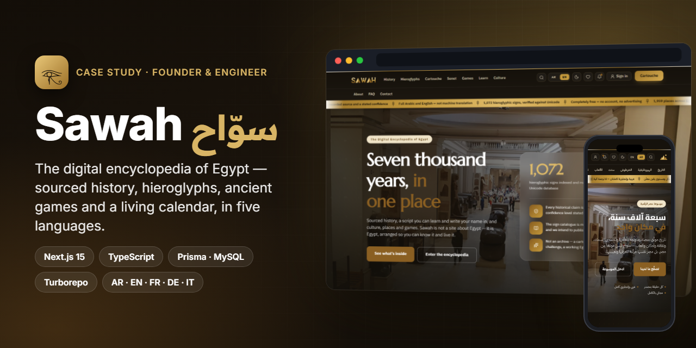

<h1 align="center">Sawah · سوّاح</h1>

<b>The digital encyclopedia of Egypt — sourced history, hieroglyphs you can write, 5,000-year-old games you can play, and the Egyptian calendar still running. In Arabic, English, French, German and Italian.</b>

  
  
  
  
  
  
  
  
  
  

> ℹ️ Case study — Sawah is my own product; its source code is private and is not included here. Everything below is taken from the real codebase, its decision log and the running site.

## Overview

**Sawah** (Arabic *سوّاح*, "traveller") is a free, ad-free digital encyclopedia of Egypt — not a site *about* Egypt, but Egypt arranged so you can know it and live it. It brings together seven thousand years of history with real sources, the hieroglyphic script (learn it, then write your own name in it), Egyptian literature, art, mythology and Egyptology, almost two thousand places, and a games arena that includes playable reconstructions of **senet** and the **Royal Game of Twenty Squares**.

| | |
|---|---|
| **Audience** | Arabic-speaking readers first, then visitors and learners worldwide |
| **Languages** | Arabic (RTL) · English · French · German · Italian — every locale routed from day one, each released by its own flag |
| **My role** | Founder, product owner and sole engineer — product decisions, architecture, data model, editorial pipeline, front end, admin panel, CI |
| **Timeline** | First commit 16 Aug 2026 → public preview late Sep 2026 (≈ 6 weeks, 177 commits) |
| **Status** | Public preview live; Phase 1 (the cartouche) and the encyclopedia skeleton shipped, more pillars behind closed flags |

## The challenge

- **Credibility is the product.** Egyptian history online is full of myths and unsourced claims. Every historical statement in Sawah had to carry a real source and a stated confidence level (`consensus` / `disputed` / `popular_myth`) — and the code had to make that easier than skipping it.
- **"Your name in hieroglyphs" is usually a gimmick.** Most generators swap letters for pictures and call it a translation. Sawah had to be fun *and* honest: a phonetic approximation, sign by sign, with the reasons.
- **Arabic-first, not Arabic-also.** Full RTL/LTR, five locales and SEO-friendly URLs, without duplicate content or a single English-only screen.
- **SEO is the acquisition channel.** An encyclopedia lives on search, so anything that hurts indexing (a client-only SPA, for example) was ruled out up front.
- **One engineer, a huge surface.** History, a script, games, tools, an admin panel and an AI assistant — so the codebase needed hard rules that a linter enforces, not good intentions.

## Highlights

**📜 Encyclopedia**
- Egyptian history in 7 eras and 26 periods, 400+ chapters, ~5,000 sources and ~95,000 recorded citations (counts measured on 26 Sep 2026)
- A catalogue of 8,500+ entries across literature, art & cinema, mythology and Egyptology; 1,959 places — museums, temples, sites — across the governorates
- Every claim linked to a source with its confidence level; user corrections kept separate from official content

**𓂀 Hieroglyphs**
- A **1,072-sign** catalogue indexed by Gardiner code and machine-verified against the Unicode database
- The **cartouche** writer: your name in hieroglyphs, sign by sign, in four styles, exportable as PNG and shareable
- Hieroglyph Academy: alphabet cards and spaced repetition (SM-2)

**🎮 Arena**
- **Senet** and **Twenty Squares**: vs. the computer at three levels, vs. a friend, or online — with replays, an interactive lesson and a daily puzzle
- A daily challenge with streaks, and quiz games (riddles, the treasure ladder, a 60-second sprint, timeline ordering, sign and cartouche rounds) over 7,500 questions

**🎭 Culture & tools**
- The **Egyptian calendar, computed live** — today in the Coptic year and in the ancient "wandering" civil year, side by side
- "Which ancient Egyptian are you?", hieroglyph wallpapers, a company-name cartouche, and an embeddable sign-of-the-day widget

**🛠️ Platform**
- **45 feature flags** (locked · internal · beta · open) flipped live from the admin panel — nothing reaches the public until it is opened
- A full admin panel: flags, catalogue, history, news, games, notices, pages and members
- "Ask Sawah" — a grounded Q&A assistant that may only answer from Sawah's own published passages

## Screens

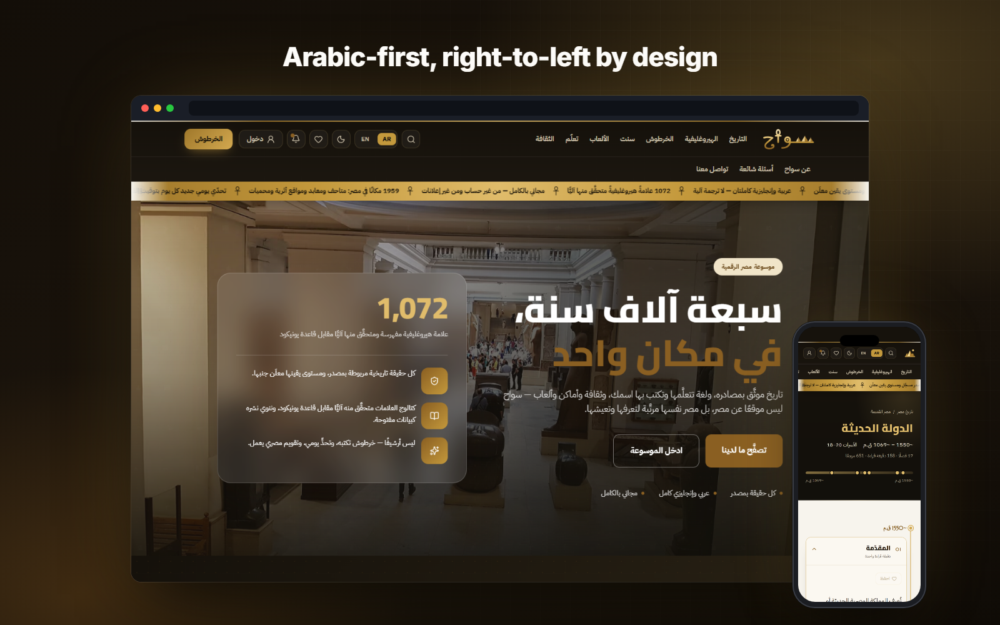

<i>The home page in Arabic (RTL) with the mobile layout of a history period.</i>

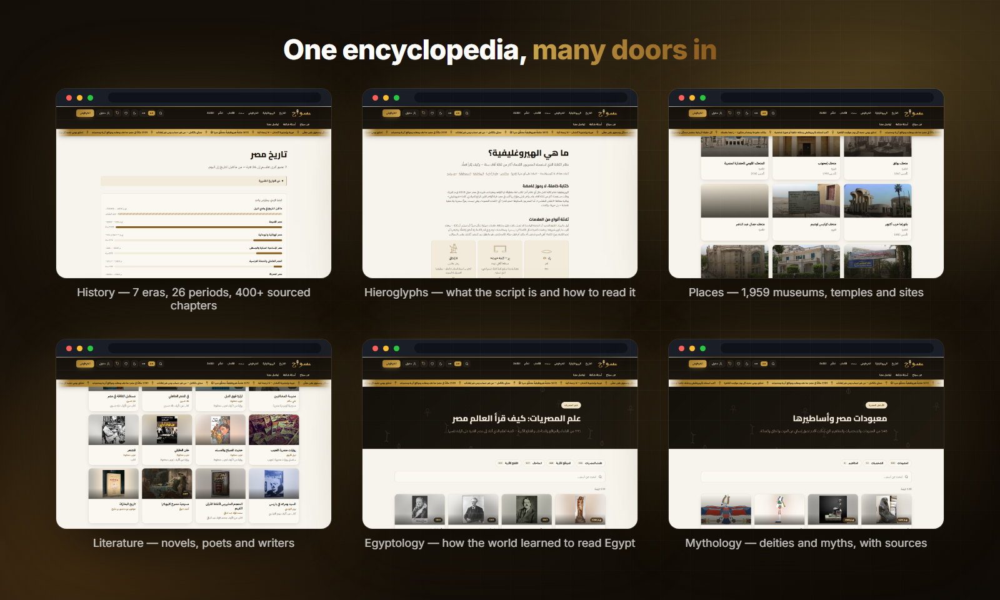

<i>Six of the doors in: history, the script, places, literature, Egyptology and mythology.</i>

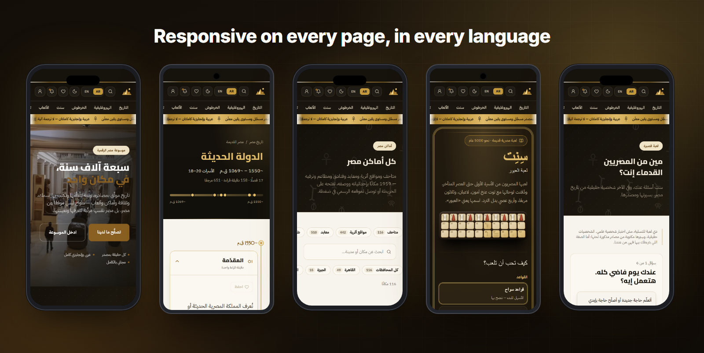

<i>Every page is responsive — home, a history period, places, senet and the "Which ancient Egyptian are you?" quiz.</i>

## Signature feature — your name in hieroglyphs

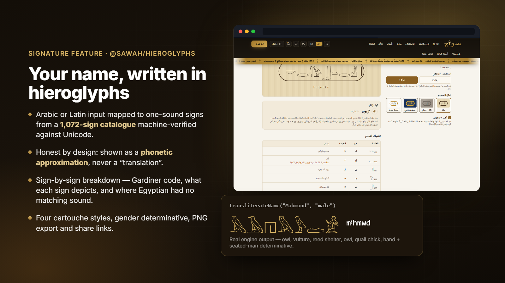

**How it works**

1. The name — in Arabic or Latin script — goes to `transliterateName()` in the pure `@sawah/hieroglyphs` package.
2. Each sound is mapped to a one-sound (uniliteral) sign from the verified catalogue; a gender determinative (seated man or woman) closes the name, as Egyptian scribes did.
3. Sounds Egyptian did not have (it does not separate *l* from *r*, for example) are flagged as approximations and explained in the sign-by-sign breakdown — Gardiner code, what the sign depicts, and the caveat.
4. The page presents the result as a **phonetic approximation, never a translation**, and notes that ancient pronunciation is a scholarly reconstruction.
5. The cartouche renders in four styles (papyrus, carved stone, gold, modern) and exports to PNG or a share link.

### More features

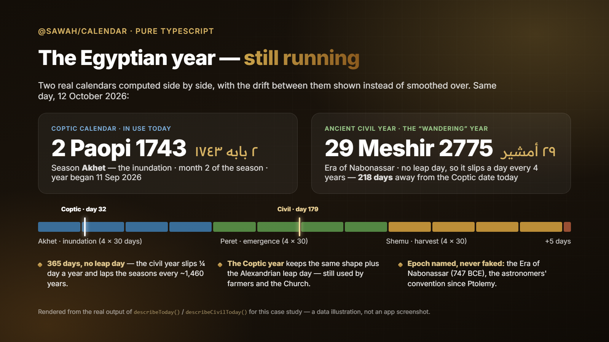

**The Egyptian calendar, still running.** `@sawah/calendar` computes two real calendars: the **Coptic** year (still used by the Church and by farmers) and the ancient **civil "wandering" year**, which had no leap day and drifts a day every four years. Instead of hiding the difference, the page shows it — on 12 October 2026 the two are 218 days apart. The civil year count uses the Era of Nabonassar (the astronomers' convention since Ptolemy) and is labelled as such, never as pharaonic usage. *The image above shows real engine output, laid out for this case study; it is not a screenshot.*

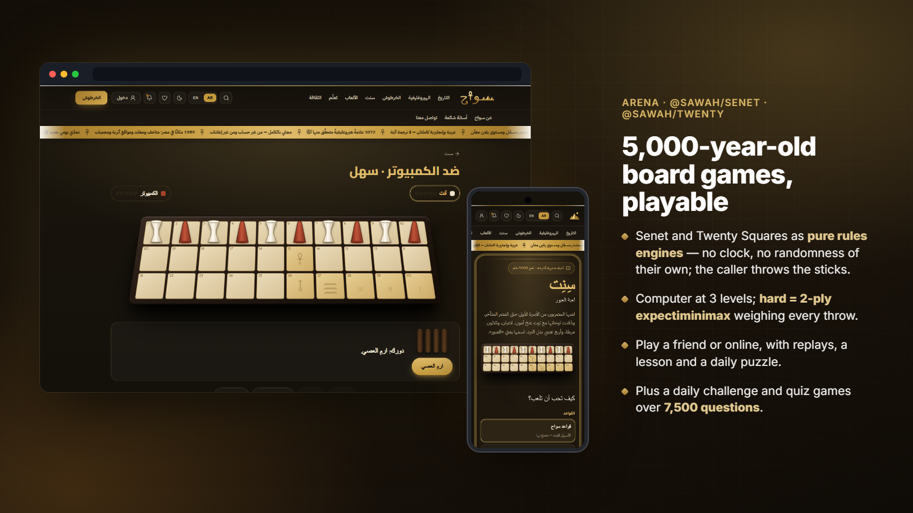

**Senet and Twenty Squares.** Both games are pure rules engines (`@sawah/senet`, `@sawah/twenty`) with the same API, so one online layer drives both. They have no clock and no randomness of their own — whoever throws the sticks passes the result in — so the browser, the server and the tests run identical rules. The computer plays at three levels; *hard* is a two-ply **expectiminimax** that weighs every throw by its probability, as backgammon programs do. Senet's branching is small, so this runs in the page without a worker.

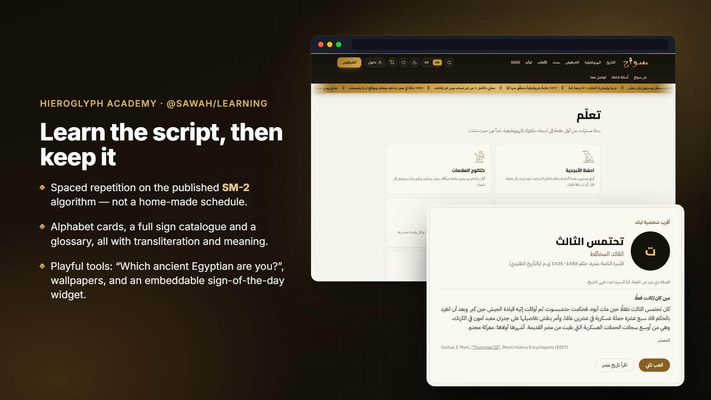

**Learn, then keep it.** `@sawah/learning` uses the published SM-2 spaced-repetition algorithm — deliberately not a home-made schedule — and knows nothing about hieroglyphs, so the same engine can drive language courses later. Results in the "Which ancient Egyptian are you?" quiz are real historical figures, each with a cited source.

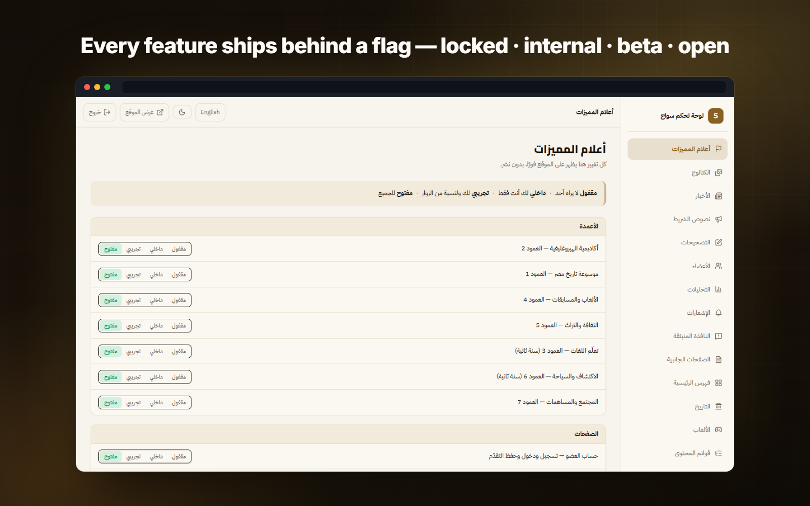

**Ship dark, open on purpose.** Every pillar, page, locale and tool sits behind one of 45 flags with four states — *locked* (nobody), *internal* (the owner), *beta* (the owner and trial visitors) and *open* (everyone). Unfinished work can live on the production site without being exposed, and nothing goes public without a decision.

## Architecture & stack

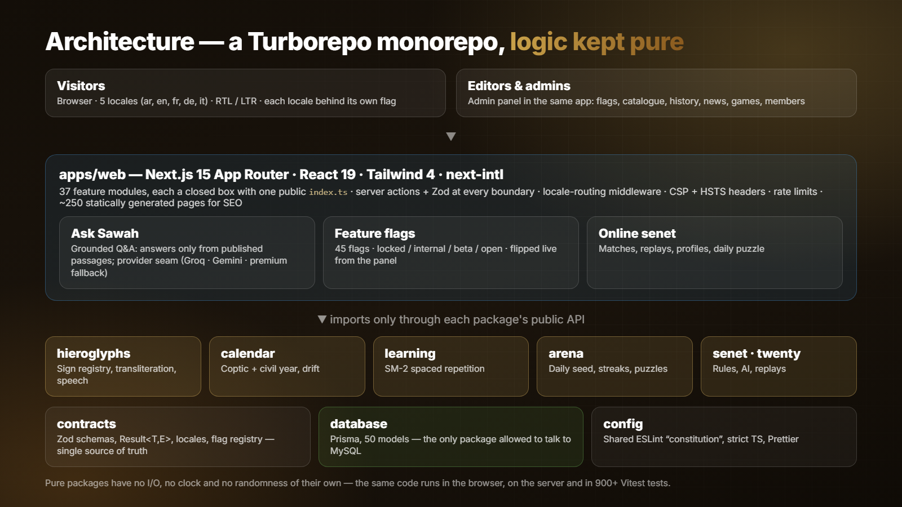

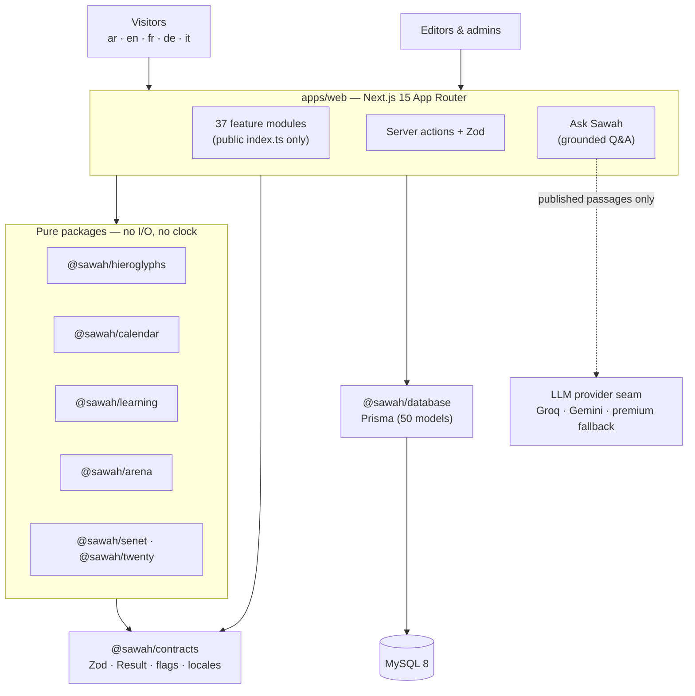

| Layer | Technology |
|---|---|
| Web app | Next.js 15 (App Router), React 19, Tailwind CSS 4, `next-intl` (5 locales, always-prefixed URLs) |
| Language | TypeScript strict + `noUncheckedIndexedAccess`; Zod at every boundary; types derived from schemas |
| Domain logic | Pure packages: `hieroglyphs`, `calendar`, `learning`, `arena`, `senet`, `twenty` |
| Shared contracts | `@sawah/contracts` — Zod schemas, `Result<T, E>`, locales, the feature-flag registry |
| Data | Prisma (50 models) on MySQL 8; `@sawah/database` is the only package allowed to query it |
| AI | "Ask Sawah": retrieval over published content → provider seam (Groq / Gemini / premium fallback model), shared answer rules, rate-limited, behind a flag |
| Monorepo | Turborepo + pnpm workspaces; shared ESLint / TS / Prettier config package |
| Quality | Vitest (130 test files, 913 tests), ESLint 9 flat config, Husky + lint-staged, GitHub Actions CI |
| Security | CSP + HSTS headers, rate limiting, scrypt-hashed admin password, secrets only in `.env` (`.env.example` kept current) |
| Hosting | Vercel (public preview) |

## Engineering notes

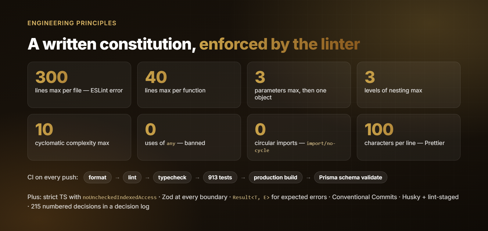

1. **A constitution enforced by the linter.** The project has a written code constitution, and the important rules are ESLint *errors*, not guidelines: 300 lines per file, 40 per function, at most 3 parameters, nesting depth 3, cyclomatic complexity 10, no `any`, no circular imports. A file that will not split is treated as a design problem, not a reason to raise the limit. `pnpm check` (format → lint → types → tests → build) is exactly what CI runs, plus a Prisma schema validation job.
2. **Pure logic, isolated I/O.** The hieroglyph engine, calendar, spaced repetition and both board games are side-effect-free packages: no database, no clock, no randomness of their own. The same code runs on the server, in the browser and in tests, and is ready for the planned mobile app without duplicating a line.
3. **Sources as data, not decoration.** History chapters, catalogue entries and places are linked to records in a `sources` table with a confidence level. Images follow the same rule: only public-domain / CC0 / CC BY / CC BY-SA files, each logged with photographer, licence and origin — the download script rejects NC and ND licences automatically.
4. **An AI assistant that cannot make things up.** A language model answering from memory produces fluent claims with no source — the opposite of the project's first rule. So "Ask Sawah" retrieves Sawah's own published passages and the period outline, and the model may answer only from those or decline. Providers sit behind one seam with shared rules (free tiers first, the strongest model as fallback), so changing the provider changes the prose, never the editorial constraints.
5. **Five languages without duplicate content.** Every locale has one canonical, prefixed URL (`/ar/…`, `/en/…`), user-facing strings exist only as i18n keys (a test checks key parity across locales), and each language is opened by its own flag — so an unfinished translation can be developed on the live site without being indexed.
6. **Decisions written down.** Every non-trivial product or technical choice is a numbered entry in a decision log (215 so far), discussed before any code is written — including reversals, such as moving from PostgreSQL to MySQL and from a stock-photo library to Wikimedia Commons.

## Results

- **Public preview live** at [sawah-egypt.vercel.app](https://sawah-egypt.vercel.app).
- Content measured from the database on 26 Sep 2026: **400+** history chapters, **~5,000** sources, **~95,000** citations, **8,500+** catalogue entries, **1,959** places, **7,500** game questions, **1,072** verified hieroglyphic signs.
- Codebase: a 9-package monorepo, **913 passing tests**, zero lint and type errors, about **250 statically generated pages**, and CI on every push.

## بالعربي

**سوّاح** موسوعة مصر الرقمية — مجانية وبلا إعلانات: تاريخ مصر كاملًا بمصادر حقيقية ومستوى يقين لكل معلومة، والهيروغليفية تتعلّمها وتكتب بها اسمك في خرطوش، وألعاب مصرية قديمة مثل **سنت** و**العشرين مربعًا** ضد الكمبيوتر أو أونلاين، والتقويم المصري (القبطي والمدني القديم) محسوبًا لحظيًا.
الموقع بخمس لغات (عربي أولًا مع RTL كامل)، ومبني بـ Next.js 15 وTypeScript وPrisma وMySQL في Monorepo منظّم.
أنا المؤسس والمهندس الوحيد: من القرار المنتجي والمعمارية لحد لوحة التحكم والـ CI.
الكود محكوم بـ«دستور» تفرضه ESLint آليًا: ٣٠٠ سطر للملف، ٤٠ للدالة، بلا `any` وبلا استيراد دائري — و٩١٣ اختبارًا.
المساعد الذكي «اسأل سوّاح» يجاوب من محتوى الموسوعة المنشور فقط — ولا يخترع.

## Links

- 🌐 Live preview — [sawah-egypt.vercel.app](https://sawah-egypt.vercel.app)
- 📷 Photographs that appear inside the screenshots are Wikimedia Commons files (public domain / CC BY / CC BY-SA), credited on the site's About page.

---
<h3 align="center">Built by Mahmoud Shaker — Senior Flutter Engineer</h3>

  
  
  
  
  
  
  

